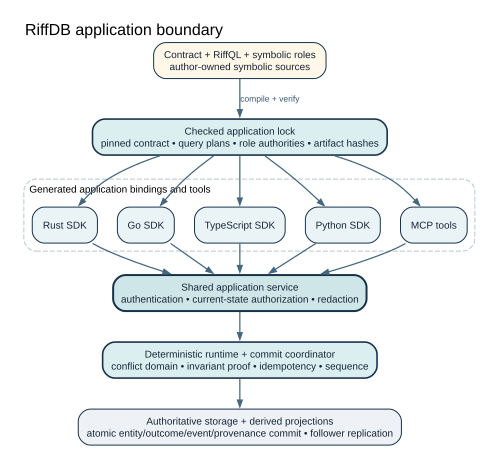

# RiffDB Handbook

RiffDB is a standalone, contract-first operational database. Applications
declare entities, commands, invariants, outcomes, queries, and least-authority
roles. They mutate state only by invoking compiled commands; RiffDB owns the
concurrency checks, idempotency record, durable outcome, provenance, events,
and projection progress.

RiffDB `0.2.x` supports single-node operation, single-primary asynchronous and
quorum-acknowledged follower replication, and incarnation-fenced primary
promotion with optional automatic failover. Read
[Compatibility](compatibility.md) and [Security](security.md) before choosing an
environment.

## Choose a path

| Goal | Start here |
|---|---|
| Understand the model | [What RiffDB Is](getting-started/WHAT-IS-RIFFDB.md) |
| Install RiffDB locally | [Installation](installation.md) |
| Build an application from scratch | [Your First Application](getting-started/FIRST-APPLICATION.md) |
| Add RiffDB to an existing repo | [Database-Shaped Project Workflow](getting-started/DATABASE-WORKFLOW.md) |
| Install language SDKs & CLI packages | [Driver and CLI Packages](getting-started/PACKAGE-INSTALLATION.md) |
| Give an agent typed database tools | [MCP Agent Cookbook](mcp/agent-cookbook.md) |
| Compare the safety model with PostgreSQL | [PostgreSQL Safety Comparison](tutorials/POSTGRESQL-COMPARISON.md) |
| Deploy a production systemd service | [Production Systemd Deployment](operations/PRODUCTION-DEPLOYMENT.md) |
| Look up a command | [CLI Reference](reference/CLI.md) |

## The application boundary



The transports do not define separate semantics. CLI, generated clients, gRPC,
and MCP all enter the same application service and authorization boundary. MCP
never opens storage directly.

## First successful loop

Initialize a starter project in an existing or new directory, generate a typed
SDK offline, and run against an ephemeral local database:

```bash
mkdir item-desk && cd item-desk
riffdb init item-desk --generator typescript --starter
riffdb generate
riffdb dev --exec 'riffdb --endpoint "$RIFFDB_ENDPOINT" --credential-file "$RIFFDB_CREDENTIAL_FILE" server health'
```

Or scaffold a complete standalone application repository with seed data:

```bash
riffdb new item-desk --language typescript
cd item-desk
riffdb dev --seed --run
```

Continue with [Your First Application](getting-started/FIRST-APPLICATION.md) for
a complete step-by-step tutorial in TypeScript, Python, Go, and Rust.

## What the database proves

- Business invariants are evaluated by the database under concurrency.
- A retry keeps one idempotency identity and recovers the committed outcome.
- A commit atomically records mutations, outcome, events, provenance, and its
  commit-log entry.
- Queries execute against one authoritative snapshot with compiler-proven
  bounds.
- Projections expose frontiers so callers can request read-after-commit
  consistency explicitly.
- Credentials expose named operations and scopes, not ambient storage access.
